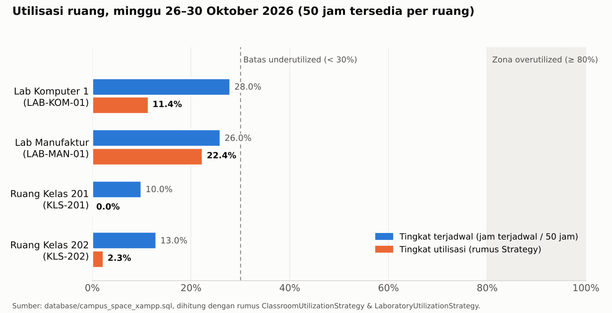

# Analisis Studi Kasus Teknik Industri: Utilisasi Ruang dan Dampak *Ghost Booking*

| Item | Isi |
|---|---|
| Issue Linear | PAD-31 [SA-05] |
| Penyusun | Najma Afifah (System Analyst) |
| Sumber data | `database/campus_space_xampp.sql` (data demo yang sama dengan hasil impor XAMPP) |
| Rumus | `app/Strategies/ClassroomUtilizationStrategy.php`, `app/Strategies/LaboratoryUtilizationStrategy.php`, `app/Support/Utilization/UtilizationPeriod.php` |
| Periode utama | Senin 26 – Jumat 30 Oktober 2026 (minggu dengan data booking lengkap) |
| Pembanding | Senin 2 – Minggu 8 November 2026 |

> **Cara mengecek ulang angka di dokumen ini:** impor `.sql` (README Cara A), login sebagai `pengelola@campus.test`,
> buka **Laporan Utilisasi**, isi tanggal **2026-10-26** s.d. **2026-11-01**. Angka di tabel aplikasi harus sama
> dengan tabel di bagian 3.

---

## 1. Latar belakang masalah

Manajemen kampus perlu tahu apakah ruang kelas dan laboratorium sudah dipakai secara efisien. Selama ini keputusan
(menambah ruang, menutup ruang, menambah jadwal praktikum) sering diambil dari **jadwal di atas kertas**, padahal
ruang yang sudah dipesan belum tentu benar-benar dipakai. Masalah terbesarnya adalah ***ghost booking***: ruang
sudah disetujui untuk dipinjam, tetapi peminjam tidak datang. Akibatnya ruang terlihat penuh di jadwal, sementara
peminjam lain ditolak atau tidak bisa memesan slot yang sama.

Sistem ini menjawab masalah tersebut dengan memisahkan dua angka:

- **Jam terjadwal**: apa yang *direncanakan* (jadwal kuliah/praktikum + booking yang disetujui).
- **Jam aktual**: apa yang *benar-benar terjadi* (durasi check-in sampai check-out lewat QR ruangan).

Selisih kedua angka ini adalah **pemborosan kapasitas** yang selama ini tidak terlihat.

---

## 2. Definisi dan rumus yang dipakai sistem

### 2.1 Jam tersedia

Jam operasional **07.00–17.00** (10 jam), **Senin–Jumat**. Satu minggu = 5 × 10 = **50 jam tersedia per ruang**.
Jam di luar rentang ini (malam hari, Sabtu, Minggu) tidak dihitung.

### 2.2 Indikator utama

| Indikator | Rumus | Makna bagi manajemen |
|---|---|---|
| Tingkat terjadwal | jam terjadwal ÷ jam tersedia × 100% | Seberapa penuh ruang *menurut jadwal* |
| Tingkat utilisasi (kelas) | jam aktual ÷ jam tersedia × 100% | Seberapa penuh ruang *sebenarnya* |
| Tingkat utilisasi (lab) | (jam aktual + 0,5 jam setup per sesi − 0,5 × jam ghost) ÷ jam tersedia × 100% | Seperti kelas, ditambah waktu persiapan alat dan dikurangi penalti slot yang ditahan tanpa dipakai |
| Rasio realisasi | jam aktual ÷ jam terjadwal × 100% | Berapa persen rencana yang benar-benar terlaksana |
| *Ghost rate* | jumlah booking `no_show` ÷ booking disetujui × 100% | Seberapa sering peminjam tidak datang |
| Okupansi kursi | Σ(peserta × jam sesi) ÷ (kapasitas × jam aktual) × 100% | Kesesuaian ukuran ruang dengan jumlah pemakai |
| Kursi-jam hilang (ghost) | Σ(peserta × durasi booking ghost) | Jumlah "kursi × jam" yang tertahan sia-sia |

Sebuah booking menjadi **ghost** bila statusnya `approved`, peminjam tidak check-in, dan sudah lewat **15 menit**
dari jam mulai. Sistem otomatis mengubah statusnya menjadi `no_show` setiap kali Laporan Utilisasi dibuka.

### 2.3 Klasifikasi ruang

| Kategori | Tingkat utilisasi | Label di aplikasi |
|---|---|---|
| *Underutilized* | < 30% | Kurang dimanfaatkan |
| Normal | 30% – < 80% | Normal |
| *Overutilized* | ≥ 80% | Sangat padat |

---

## 3. Hasil perhitungan: minggu 26–30 Oktober 2026

Pada minggu ini, empat ruang di Gedung FRI memiliki aktivitas. Ruang lain (termasuk seluruh ruang di TULT) tidak
memiliki jadwal maupun booking, sehingga utilisasinya 0%.

| Ruang | Tipe | Kapasitas | Jam terjadwal | Tingkat terjadwal | Jam aktual | **Utilisasi** | Realisasi | Booking disetujui | Ghost | Okupansi kursi | Kategori |
|---|---|---:|---:|---:|---:|---:|---:|---:|---:|---:|---|
| LAB-KOM-01 Lab Komputer 1 | Lab | 40 | 14,0 | 28,0% | 6,22 | **11,4%** | 44,4% | 5 | **2 (40%)** | 54,9% | Underutilized |
| LAB-MAN-01 Lab Manufaktur | Lab | 30 | 13,0 | 26,0% | 9,70 | **22,4%** | 74,6% | 3 | 0 | **94,2%** | Underutilized |
| KLS-201 Ruang Kelas 201 | Kelas | 60 | 5,0 | 10,0% | 0,00 | **0,0%** | 0,0% | 0 | 0 | – | Underutilized |
| KLS-202 Ruang Kelas 202 | Kelas | 40 | 6,5 | 13,0% | 1,17 | **2,3%** | 17,9% | 2 | **1 (50%)** | 20,0% | Underutilized |

Rincian perhitungan lab (contoh LAB-KOM-01):

- Jam aktual = 1,92 jam (booking #1, 10.05–12.00) + 1,50 jam (#2, 13.00–14.30) + 2,80 jam (#4, 13.12–16.00) = **6,22 jam**
- Setup = 3 sesi terpakai × 0,5 jam = **1,5 jam**
- Penalti ghost = 4 jam ghost (#3 dan #5) × 0,5 = **2,0 jam**
- Utilisasi = (6,22 + 1,5 − 2,0) ÷ 50 = 5,72 ÷ 50 = **11,4%** (tanpa setup dan penalti: 12,4%)

### 3.1 Rekap keempat ruang aktif

| Komponen | Jam | Porsi dari 200 jam tersedia |
|---|---:|---:|
| Jam tersedia (4 ruang × 50 jam) | 200,0 | 100% |
| Jam terjadwal | 38,5 | 19,3% |
| └ Jadwal kuliah/praktikum reguler | 13,5 | |
| └ Booking disetujui | 25,0 | |
| Jam aktual (tercatat check-in/out) | 17,1 | **8,5%** |
| **Selisih terjadwal − aktual** | **21,4** | |
| └ Jadwal reguler tanpa check-in | 13,5 | |
| └ *Ghost booking* (3 booking) | 6,0 | |
| └ Datang terlambat / pulang lebih awal | 1,9 | |

---

## 4. Interpretasi untuk manajemen kampus

### 4.1 Ruang *underutilized*

**Semua ruang aktif masuk kategori *underutilized* (< 30%).** Tidak ada satu ruang pun yang mendekati batas
*overutilized* (80%). Bahkan menurut jadwal saja, ruang terpadat (Lab Komputer 1) baru terisi 28% dari jam tersedia.

Artinya, **kampus tidak kekurangan ruang; kampus kekurangan pemakaian.** Usulan pembangunan atau penyewaan ruang
baru belum bisa dibenarkan dengan data ini.

Catatan per ruang:

1. **Ruang Kelas 202 (2,3%)**: kasus paling boros. Ruang 40 kursi dipakai rapat 8 orang (okupansi kursi 20%), dan
   satu-satunya booking lain adalah *ghost* (belajar kelompok 6 orang). Waktu yang hilang karena ghost (2 jam) lebih
   besar daripada waktu yang benar-benar dipakai (1,17 jam). Ruang ini cocok dijadikan prioritas pertama untuk
   **ruang diskusi kecil** atau digabung jadwalnya dengan KLS-201.
2. **Ruang Kelas 201 (0%)**: punya 5 jam kuliah terjadwal, tetapi tidak ada check-in, sehingga utilisasi tercatat 0%.
   Ini lebih mungkin **masalah pencatatan** daripada ruang kosong (lihat 4.4).
3. **Lab Komputer 1 (11,4%)**: permintaannya ada (tingkat terjadwal tertinggi, 28%), tetapi **40% booking-nya ghost**.
   Ruang ini kehilangan lebih dari separuh potensinya karena peminjam tidak datang, bukan karena tidak diminati.
4. **Lab Manufaktur (22,4%)**: ruang dengan **disiplin pemakaian terbaik** (realisasi 74,6%, tanpa ghost). Lihat 4.2.

### 4.2 Gejala *overutilized* yang tersembunyi: Lab Manufaktur

Walau secara jam masih *underutilized*, Lab Manufaktur menunjukkan **tekanan kapasitas kursi**: okupansi kursi
94,2%, dan workshop *lean manufacturing* (28 Okt) diikuti 30 peserta di lab berkapasitas 30, alias penuh 100%.
Selain itu, fasilitas *conveyor* simulasi lini produksi di lab ini berstatus **rusak**.

Interpretasinya: masalah Lab Manufaktur **bukan kekurangan jam, tetapi kekurangan kursi per sesi** dan fasilitas yang
tidak siap. Bila jumlah peserta praktikum naik, lab ini yang pertama kali penuh. Solusinya adalah memecah kelas
praktikum menjadi dua sesi (jamnya masih banyak tersisa, 77,6%) dan memperbaiki conveyor, bukan membangun lab baru.

> Sistem sudah menyiapkan rekomendasi kapasitas otomatis (persentil ke-90 jumlah peserta × 1,1). Saat ini
> rekomendasi berstatus *insufficient data* karena setiap ruang baru punya ≤ 3 sesi terpakai, di bawah syarat
> minimal 5 sesi. Setelah sistem berjalan beberapa minggu, angka ini bisa langsung dipakai.

### 4.3 Dampak *ghost booking*

| Ruang | Booking ghost | Jam tertahan | Kursi-jam hilang | Pengaruh ke utilisasi |
|---|---|---:|---:|---|
| LAB-KOM-01 | #3 Pelatihan Excel HMTI (30 org, 2 jam); #5 Asistensi praktikum (15 org, 2 jam) | 4,0 | 90 | Bila dipakai, utilisasi mentah naik dari 12,4% → **20,4%**. Penalti ghost juga memotong 2 jam (4 poin persen) dari angka lab. |
| KLS-202 | #10 Belajar kelompok (6 org, 2 jam) | 2,0 | 12 | Bila dipakai, utilisasi naik dari 2,3% → **6,3%** |
| **Total** | **3 dari 10 booking disetujui (30%)** | **6,0** | **102** | **24%** dari seluruh jam booking yang disetujui tidak dipakai |

Dampak bagi kampus:

1. **Kapasitas semu.** Seperempat jam booking yang disetujui ternyata kosong. Di jadwal, ruang tampak terisi;
   kenyataannya tidak.
2. **Biaya peluang.** 102 kursi-jam hilang setara dengan Lab Komputer 1 **terisi penuh 40 kursi selama ±2,5 jam**
   (102 ÷ 40 ≈ 2,5), waktu yang sebenarnya bisa diberikan ke peminjam lain.
3. **Keadilan akses.** Slot ghost di Lab Komputer 1 terjadi pada jam kerja utama (08.00–10.00 dan 13.00–15.00),
   tepat pada jam yang paling banyak diminta mahasiswa dan dosen.
4. **Biaya operasional tetap jalan.** Lab yang sudah disetujui biasanya disiapkan (AC, PC, laboran) walau tidak
   dipakai, sehingga energi dan tenaga terbuang.
5. **Pola peminjam.** Dua dari tiga ghost berasal dari kegiatan organisasi/belajar kelompok mahasiswa, dan satu dari
   asistensi dosen. Ghost tidak terbatas pada satu kelompok pengguna, sehingga kebijakannya perlu berlaku umum.

### 4.4 Catatan keandalan data (penting sebelum mengambil keputusan)

1. **Jadwal kuliah reguler tidak tercatat sebagai jam aktual.** Utilisasi hanya dihitung dari booking yang di-check-in.
   Jadwal kuliah/praktikum (13,5 jam pada minggu ini) tidak pernah di-check-in, sehingga KLS-201 tampil 0% walau ada
   kuliah. Akibatnya utilisasi **ruang kelas tercatat lebih rendah dari kenyataan**. Angka utilisasi kelas sebaiknya
   dibaca bersama *tingkat terjadwal*.
2. **Booking di luar jam operasional tidak terhitung**, tetapi waktu setup lab tetap terhitung. Contoh pada minggu
   2–8 November: R2 (TULT-0807) dan R7 (TULT-0913) hanya punya sesi pada Sabtu/Minggu atau malam hari. Jam aktualnya
   0, tetapi utilisasinya tercatat 1,0% karena 0,5 jam setup tetap dijumlahkan. Selisihnya kecil, tetapi sebaiknya
   setup hanya dihitung untuk sesi di dalam jam operasional (catatan untuk tim BE).
3. **Data adalah data demo** dengan jumlah booking kecil (10 booking pada minggu utama). Pola di dokumen ini menunjukkan
   cara membaca sistem, bukan kondisi kampus sebenarnya. Analisis yang sama perlu diulang setelah minimal 4 minggu data nyata.

### 4.5 Pembanding: minggu 2–8 November 2026

Pada minggu ini, ruang di TULT memiliki jadwal tetap (R1, R3, R5, R6, R8 masing-masing 6 jam = 12% terjadwal),
sedangkan seluruh ruang FRI kosong. Karena semua aktivitas berupa jadwal reguler tanpa check-in, utilisasi
tercatat 0–1% untuk semua ruang. Ini menegaskan catatan 4.4 nomor 1: **tanpa check-in untuk kuliah reguler,
laporan tidak bisa membedakan kelas yang benar-benar berlangsung dari kelas yang batal.**

---

## 5. Rekomendasi untuk manajemen kampus

| No | Rekomendasi | Masalah yang diatasi | Indikator keberhasilan |
|---|---|---|---|
| 1 | **Tunda penambahan ruang baru.** Optimalkan ruang yang ada, mulai dari KLS-202 dan KLS-201. | Semua ruang < 30% | Rata-rata utilisasi ruang aktif naik ke ≥ 30% (kategori Normal) |
| 2 | **Kebijakan sanksi ghost booking**: peminjam dengan 2 kali `no_show` dalam satu bulan tidak bisa memesan selama 2 minggu. | Ghost rate 30%, 24% jam booking hilang | Ghost rate < 10% |
| 3 | **Pengingat otomatis** 30 menit sebelum jam mulai, dengan tombol "Batalkan" agar slot kembali tersedia. | Peminjam lupa atau batal tanpa memberi tahu | Lebih banyak pembatalan sebelum jadwal, lebih sedikit `no_show` |
| 4 | **Wajibkan check-in QR untuk kuliah/praktikum reguler** (dosen atau asisten memindai QR saat kelas dimulai). | Utilisasi kelas tercatat terlalu rendah (KLS-201 0%) | Jam aktual kelas ≈ jam jadwal; kelas batal terdeteksi |
| 5 | **Pecah sesi praktikum Lab Manufaktur** menjadi dua kelompok dan **perbaiki conveyor** yang rusak. | Okupansi kursi 94%, sesi penuh 100% | Okupansi kursi 70–85% per sesi |
| 6 | **Arahkan kegiatan kecil (≤ 10 orang) ke ruang diskusi kecil**, bukan ruang 40–60 kursi. | KLS-202 dipakai 8 orang (okupansi kursi 20%) | Okupansi kursi ruang kelas ≥ 50% |
| 7 | **Tinjau Laporan Utilisasi setiap minggu** (Kepala Lab dan Wakil Dekan II), dengan fokus pada kolom *Ghost* dan *Realisasi*. | Keputusan masih berbasis jadwal | Keputusan ruang tercatat dengan data utilisasi aktual |

---

## 6. Kesimpulan

1. Seluruh ruang aktif berada pada kategori **underutilized** (2,3%–22,4%). Tidak ada ruang *overutilized*. Kampus
   **tidak kekurangan ruang**, sehingga prioritasnya adalah meningkatkan pemakaian ruang yang sudah ada.
2. **Ghost booking** menghilangkan **6 jam ruang dan 102 kursi-jam** dalam satu minggu, atau **24%** dari jam booking
   yang disetujui. Lab Komputer 1 paling terdampak (40% booking-nya ghost).
3. **Lab Manufaktur** adalah satu-satunya ruang dengan tanda kepadatan, yaitu kursi (94%), bukan jam. Solusinya
   penjadwalan ulang dan perbaikan fasilitas, bukan pembangunan.
4. Agar laporan dapat diandalkan untuk keputusan investasi, **kuliah reguler perlu check-in QR**. Tanpa itu,
   utilisasi ruang kelas selalu tercatat terlalu rendah.
