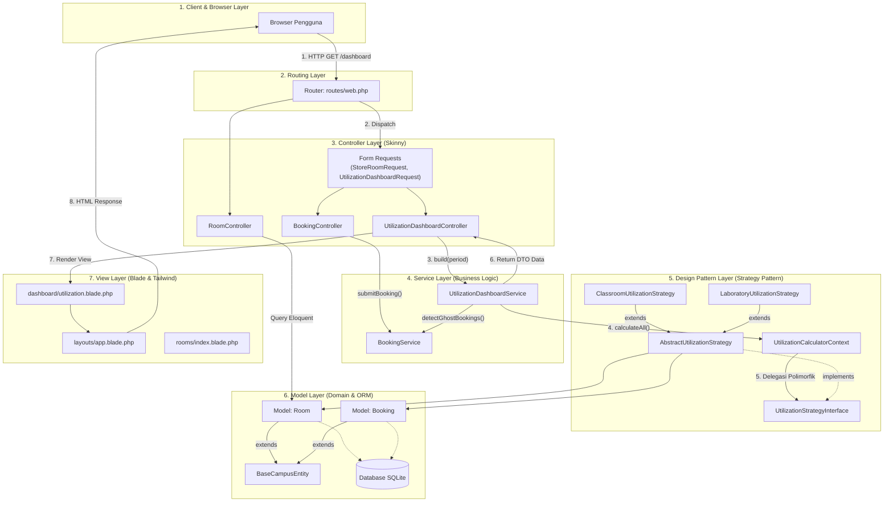
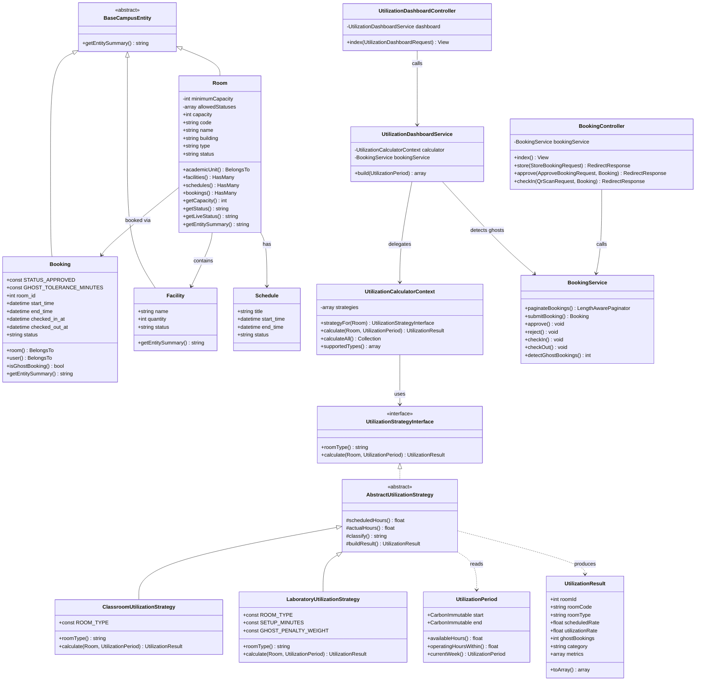

# LAPORAN KEMAJUAN (PROGRESS REPORT)
## Campus Space & Laboratory Utilization System
**Mata Kuliah:** Perancangan Aplikasi Dinamis (PAD) — Kelompok 1  
**Repositori:** `https://github.com/yardan1204/PAD_Kelompok-1.git`  
**Sifat Dokumen:** Laporan Evaluasi Teknis Berbasis Rubrikasi Penilaian

---

## DAFTAR ISI LAPORAN
1. [PENDAHULUAN & KONTEKS MASALAH](#1-pendahuluan--konteks-masalah)
2. [POIN 1: Struktur MVC dan Pemisahan Tanggung Jawab](#2-poin-1-struktur-mvc-dan-pemisahan-tanggung-jawab)
   - 2.1 Routing Terpusat & Deklaratif
   - 2.2 Isolasi Validasi pada Lapisan Form Request
   - 2.3 Penerapan *Skinny Controller*
   - 2.4 Enkapsulasi Logika Transaksional pada Service Layer
   - 2.5 Model Enkapsulasi & Aturan Integritas Domain
   - 2.6 View Pasif Tanpa Logika Bisnis (*Dumb View*)
3. [POIN 2: Penerapan Pola Desain Pendukung (Strategy Pattern)](#3-poin-2-penerapan-pola-desain-pendukung-strategy-pattern)
   - 3.1 Rasionalisasi Pemilihan Pola Desain
   - 3.2 Kontrak Antarmuka Polimorfik (`UtilizationStrategyInterface`)
   - 3.3 Strategi Konkret 1: Ruang Kelas Reguler (`ClassroomUtilizationStrategy`)
   - 3.4 Strategi Konkret 2: Laboratorium Praktikum (`LaboratoryUtilizationStrategy`)
   - 3.5 Integrasi Context & Inversion of Control (`AppServiceProvider`)
4. [POIN 3: Kemudahan Pemeliharaan (Maintainability: Aturan ≤ 2 File)](#4-poin-3-kemudahan-pemeliharaan-maintainability-aturan--2-file)
   - 4.1 Pembuktian Kuantitatif Ekstensibilitas (Open/Closed Principle)
   - 4.2 Jaminan Ketiadaan Regresi (*Zero Regression*)
5. [POIN 4: Diagram Arsitektur dan Diagram Kelas](#5-poin-4-diagram-arsitektur-dan-diagram-kelas)
   - 5.1 Diagram Arsitektur MVC & Alur Data Berlapis (*Layered Flow*)
   - 5.2 Diagram Kelas Lengkap (UML Class Diagram)
6. [POIN 5: Log AI dan Refleksi Kritis](#6-poin-5-log-ai-dan-refleksi-kritis)
   - 6.1 Tata Kelola & Sistem Pencatatan Otomatis Aktivitas AI
   - 6.2 Refleksi Kasus 1: Koreksi Penempatan Konstanta Domain
   - 6.3 Refleksi Kasus 2: Penolakan Konvensi Naming & Redesain Antarmuka Dashboard
7. [LAMPIRAN: Hasil Verifikasi Pengujian Otomatis](#7-lampiran-hasil-verifikasi-pengujian-otomatis)

---

## 1. Pendahuluan & Konteks Masalah

* **Latar Belakang Akademis:**
  Pengelolaan fasilitas ruang perkuliahan dan laboratorium di lingkungan perguruan tinggi kerap menghadapi tantangan inefisiensi alokasi. Dua anomali utama yang teridentifikasi dalam penelitian awal adalah:
  1. **Fenomena *Ghost Booking***: Kondisi di mana permohonan peminjaman ruangan telah disetujui secara administratif (*approved*), namun peminjam tidak hadir di lokasi (*no-show*). Hal ini menyebabkan ruangan tertahan secara sistem, sehingga menghalangi civitas akademika lain yang membutuhkan fasilitas tersebut.
  2. **Heterogenitas Karakteristik Ruangan**: Komputasi efisiensi ruang perkuliahan reguler tidak dapat disamaratakan dengan laboratorium praktikum. Ruang kelas menitikberatkan pada durasi perkuliahan dan okupansi kursi (*seat occupancy*), sedangkan laboratorium memiliki waktu setup/kalibrasi peralatan (30 menit) serta dampak kerugian yang lebih tinggi saat terjadi *ghost booking*.
  
* **Solusi Sistemik:**
  Sistem *Campus Space & Laboratory Utilization System* dikembangkan untuk memantau status ruangan secara *real-time*, menghitung tingkat pemanfaatan secara adaptif menggunakan algoritma polimorfik, serta mendeteksi *ghost booking* secara otomatis.

---

## 2. POIN 1: Struktur MVC dan Pemisahan Tanggung Jawab
> **Kriteria Rubrikasi:** *Model, view, controller terpisah jelas; controller tipis, view tanpa logika bisnis, ada router.*

### 2.1 Routing Terpusat & Deklaratif
* **Penjelasan Akademis:**
  Sesuai dengan prinsip *Separation of Concerns*, berkas `routes/web.php` difungsikan murni sebagai *endpoint dispatcher*. Seluruh rute menggunakan konvensi *named routes* dan tidak memuat penanganan logika bisnis (*business logic*) atau manipulasi basis data secara langsung.
* **Evidence Bukti Kodingan (`routes/web.php: Baris 9–35`):**
```php
// routes/web.php (Baris 9 - 35)
// ==========================================
// 1. HALAMAN UTAMA (LANDING / HOME)
// ==========================================
// Rute awal '/' langsung diarahkan ke Dashboard Utilisasi
Route::get('/', [
    UtilizationDashboardController::class,
    'index',
])->name('home');

// ==========================================
// 2. MANAJEMEN RUANG & LAB (ROOMS)
// ==========================================

Route::get('/rooms', [
    RoomController::class,
    'index',
])->name('rooms.index');

Route::get('/rooms/create', [
    RoomController::class,
    'create',
])->name('rooms.create');

Route::post('/rooms', [
    RoomController::class,
    'store',
])->name('rooms.store');
```

---

### 2.2 Isolasi Validasi pada Lapisan Form Request
* **Penjelasan Akademis:**
  Untuk mencegah penumpukan logika verifikasi data masukan HTTP pada Controller, validasi diisolasi ke dalam lapisan *Form Request* mandiri (`app/Http/Requests/`). Pendekatan ini menjamin bahwa hanya data yang memenuhi kaidah integritas domain yang dapat diproses lebih lanjut oleh Controller.
* **Evidence Bukti Kodingan (`app/Http/Requests/StoreRoomRequest.php: Baris 23–70`):**
```php
// app/Http/Requests/StoreRoomRequest.php (Baris 23 - 70)
    public function rules(): array
    {
        return [
            'academic_unit_id' => [
                'required',
                'integer',
                'exists:academic_units,id',
            ],
            'code' => [
                'required',
                'string',
                'max:30',
                Rule::unique('rooms', 'code'),
            ],
            'name' => [
                'required',
                'string',
                'max:150',
            ],
            'building' => [
                'required',
                'string',
                'max:100',
            ],
            'floor' => [
                'nullable',
                'string',
                'max:30',
            ],
            'capacity' => [
                'required',
                'integer',
                'min:1',
            ],
            'status' => [
                'required',
                Rule::in([
                    'available',
                    'occupied',
                    'maintenance',
                ]),
            ],
            'description' => [
                'nullable',
                'string',
            ],
        ];
    }
```

---

### 2.3 Penerapan *Skinny Controller*
* **Penjelasan Akademis:**
  Arsitektur Controller dirancang tipis (*Skinny Controller*) dengan panjang rata-rata hanya 30 baris kode. Controller murni bertindak sebagai mediator yang mengarahkan masukan tervalidasi ke lapisan *Service Layer*, lalu meneruskan hasilnya ke lapisan presentasi (*View* atau respons JSON).
* **Evidence Bukti Kodingan (`app/Http/Controllers/UtilizationDashboardController.php: Baris 15–36`):**
```php
// app/Http/Controllers/UtilizationDashboardController.php (Baris 15 - 36)
class UtilizationDashboardController extends Controller
{
    public function __construct(
        private readonly UtilizationDashboardService $dashboard
    ) {
    }

    /**
     * Live dashboard utilisasi (default: minggu berjalan).
     * Tambahkan header Accept: application/json untuk mendapat data JSON.
     */
    public function index(UtilizationDashboardRequest $request): View|JsonResponse
    {
        $data = $this->dashboard->build($request->period());

        if ($request->expectsJson()) {
            return response()->json($data);
        }

        return view('dashboard.utilization', $data);
    }
}
```

---

### 2.4 Enkapsulasi Logika Transaksional pada Service Layer
* **Penjelasan Akademis:**
  Komputasi kompleks dan proses transaksional—seperti verifikasi ketersediaan ruang, validasi kapasitas terhadap jumlah peserta, pencegahan bentrok jadwal perkuliahan resmi, dan deteksi otomatis status *ghost booking*—ditempatkan secara terpusat pada *Service Layer* (`BookingService` dan `UtilizationDashboardService`).
* **Evidence Bukti Kodingan (`app/Services/BookingService.php: Baris 42–61`):**
```php
// app/Services/BookingService.php (Baris 42 - 61)
    public function submitBooking(User $user, array $data): Booking
    {
        $room = Room::findOrFail($data['room_id']);

        $booking = new Booking([
            'room_id' => $room->id,
            'user_id' => $user->id,
            'purpose' => $data['purpose'],
            'participant_count' => $data['participant_count'],
            'start_time' => $data['start_time'],
            'end_time' => $data['end_time'],
            'status' => Booking::STATUS_PENDING,
        ]);

        $this->checkRoomAvailability($room);
        $this->checkCapacity($room, $booking->participant_count);
        $this->checkScheduleConflict($booking);

        return $this->saveBooking($booking);
    }
```

---

### 2.5 Model Enkapsulasi & Aturan Integritas Domain
* **Penjelasan Akademis:**
  Model Eloquent berfungsi mengelola pemetaan data dan menjaga aturan integritas domain. Sebagai contoh, mutator kapasitas ruangan pada model `Room` secara ketat menolak nilai integer non-positif dengan melempar `InvalidArgumentException`.
* **Evidence Bukti Kodingan (`app/Models/Room.php: Baris 87–108`):**
```php
// app/Models/Room.php (Baris 87 - 108)
    // Mutator: validasi kapasitas untuk seluruh assignment Eloquent
    protected function capacity(): Attribute
    {
        return Attribute::make(
            set: function ($value) {
                $value = filter_var(
                    $value,
                    FILTER_VALIDATE_INT
                );

                if (
                    $value === false ||
                    $value < $this->minimumCapacity
                ) {
                    throw new InvalidArgumentException(
                        'Kapasitas ruangan minimal 1 orang.'
                    );
                }

                return $value;
            }
        );
    }
```

---

### 2.6 View Pasif Tanpa Logika Bisnis (*Dumb View*)
* **Penjelasan Akademis:**
  Lapisan *View* murni bertindak sebagai komponen presentasi grafis berbasis Blade. Berkas tampilan tidak mengeksekusi kueri basis data dan tidak memuat kalkulasi matematika, melainkan hanya menyajikan *Data Transfer Object* (DTO) yang telah diproses oleh backend.
* **Evidence Bukti Kodingan (`resources/views/dashboard/utilization.blade.php: Baris 248–257 & 281–284`):**
```blade
{{-- resources/views/dashboard/utilization.blade.php (Baris 248 - 257 & 281 - 284) --}}
{{-- Terjadwal --}}
<td class="w-44 px-4 py-3">
    <div class="flex items-baseline justify-between text-xs">
        <span class="font-semibold tabular-nums text-slate-800">{{ $room['scheduled_rate'] }}%</span>
        <span class="text-slate-500 tabular-nums">{{ $room['scheduled_hours'] }} jam</span>
    </div>
    <div class="mt-1.5">
        <x-progress-bar :value="$room['scheduled_rate']" color="bg-indigo-500" />
    </div>
</td>

{{-- Kategori --}}
<td class="whitespace-nowrap px-4 py-3">
    <x-status-badge :status="$room['category']" />
</td>
```

---

## 3. POIN 2: Penerapan Pola Desain Pendukung (Strategy Pattern)
> **Kriteria Rubrikasi:** *Satu pola (Factory, Strategy, Singleton) tepat guna dan alasan dipilihnya jelas.*

### 3.1 Rasionalisasi Pemilihan Pola Desain
* **Alasan Pemilihan Strategy Pattern:**
  1. **Penghindaran *Conditional Code Smell*:** Menghitung utilisasi untuk berbagai jenis ruangan menggunakan percabangan `if-else` atau `switch-case` melanggar *Open/Closed Principle* (OCP). Setiap penambahan jenis ruangan baru akan memaksa modifikasi kode yang telah berjalan stabil.
  2. **Pencegahan *Fat Model*:** Model `Room` merepresentasikan struktur fisik ruangan, bukan mesin inferensi matematis. Memasukkan rumus perhitungan ke dalam model akan melanggar *Single Responsibility Principle* (SRP).
  3. **Solusi Desain:** Masing-masing algoritma diisolasi ke dalam kelas konkret tersendiri yang mengimplementasikan antarmuka bersama (*Strategy Pattern*), sehingga algoritma dapat saling dipertukarkan secara polimorfik pada saat *runtime*.

---

### 3.2 Kontrak Antarmuka Polimorfik (`UtilizationStrategyInterface`)
* **Penjelasan Akademis:**
  `UtilizationStrategyInterface` mendefinisikan kontrak formal yang mengikat setiap implementasi strategi untuk menyediakan identitas tipe ruangan (`roomType()`) dan method kalkulasi utilisasi (`calculate()`).
* **Evidence Bukti Kodingan (`app/Strategies/UtilizationStrategyInterface.php: Baris 15–24`):**
```php
// app/Strategies/UtilizationStrategyInterface.php (Baris 15 - 24)
interface UtilizationStrategyInterface
{
    /**
     * Tipe ruang (rooms.type) yang ditangani Strategy ini. Kembalikan string
     * langsung (mis. 'auditorium'); tidak perlu menambah konstanta di Room.
     */
    public function roomType(): string;

    public function calculate(Room $room, UtilizationPeriod $period): UtilizationResult;
}
```

---

### 3.3 Strategi Konkret 1: Ruang Kelas Reguler (`ClassroomUtilizationStrategy`)
* **Penjelasan Akademis:**
  Algoritma pada ruang kelas reguler menitikberatkan pada perbandingan durasi pemakaian aktual terhadap ketersediaan jam operasional, disertai evaluasi rasio realisasi jadwal dan persentase keterisian kursi terhadap kapasitas fisik ruangan (*seat occupancy ratio*).
* **Evidence Bukti Kodingan (`app/Strategies/ClassroomUtilizationStrategy.php: Baris 33–60`):**
```php
// app/Strategies/ClassroomUtilizationStrategy.php (Baris 33 - 60)
        $usedSessions = $bookings->filter(
            fn ($booking) => $booking->checked_in_at !== null
        );

        $capacity = $room->getCapacity();
        $seatOccupancy = ($usedSessions->isNotEmpty() && $capacity > 0)
            ? round(
                $usedSessions->avg(
                    fn ($booking) => min(1, $booking->participant_count / $capacity)
                ) * 100,
                1
            )
            : null;

        return $this->buildResult(
            $room,
            $period,
            $bookings,
            $scheduled,
            $actual,
            $this->percentage($actual, $period->availableHours()),
            [
                'realization_ratio' => $scheduled > 0
                    ? $this->percentage($actual, $scheduled)
                    : null,
                'seat_occupancy_ratio' => $seatOccupancy,
            ]
        );
```

---

### 3.4 Strategi Konkret 2: Laboratorium Praktikum (`LaboratoryUtilizationStrategy`)
* **Penjelasan Akademis:**
  Mengakomodasi faktor spesifik laboratorium, yaitu:
  - **Waktu Setup Peralatan (`SETUP_MINUTES = 30`)**: Dialokasikan 30 menit per sesi praktikum aktif sebagai jam produktif ruangan guna penyiapan perangkat laboratorium.
  - **Bobot Penalti *Ghost Booking* (`GHOST_PENALTY_WEIGHT = 0.5`)**: Menerapkan reduksi 50% terhadap jam terpakai untuk setiap slot yang tertahan tanpa kehadiran, sebagai kompensasi inefisiensi instrumen praktikum yang menganggur.
* **Evidence Bukti Kodingan (`app/Strategies/LaboratoryUtilizationStrategy.php: Baris 24–56`):**
```php
// app/Strategies/LaboratoryUtilizationStrategy.php (Baris 24 - 56)
    public const SETUP_MINUTES = 30;
    public const GHOST_PENALTY_WEIGHT = 0.5;

    public const ROOM_TYPE = 'laboratory';

    public function roomType(): string
    {
        return self::ROOM_TYPE;
    }

    public function calculate(Room $room, UtilizationPeriod $period): UtilizationResult
    {
        $bookings = $this->approvedBookings($room, $period);
        $scheduled = $this->scheduledHours($room, $period, $bookings);
        $actual = $this->actualHours($bookings, $period);

        $usedSessions = $bookings->filter(
            fn ($booking) => $booking->checked_in_at !== null
        )->count();

        $setupHours = $usedSessions * self::SETUP_MINUTES / 60;

        $ghostHours = $bookings
            ->filter(fn ($booking) => $booking->isGhostBooking())
            ->sum(fn ($booking) => $period->operatingHoursWithin(
                $booking->start_time,
                $booking->end_time
            ));

        $penaltyHours = $ghostHours * self::GHOST_PENALTY_WEIGHT;

        $effectiveHours = max(0.0, $actual + $setupHours - $penaltyHours);
```

---

### 3.5 Integrasi Context & Inversion of Control (`AppServiceProvider`)
* **Penjelasan Akademis:**
  `UtilizationCalculatorContext` menerima sekumpulan strategi secara dinamis (*decoupled*) dan mengeksekusi strategi yang sesuai berdasarkan atribut tipe ruangan. Registrasi strategi ditangani oleh IoC Container pada `AppServiceProvider`.
* **Evidence Bukti Kodingan (`app/Providers/AppServiceProvider.php: Baris 21–28`):**
```php
// app/Providers/AppServiceProvider.php (Baris 21 - 28)
        $this->app->bind(UtilizationCalculatorContext::class, function ($app) {
            $strategies = [
                $app->make(ClassroomUtilizationStrategy::class),
                $app->make(LaboratoryUtilizationStrategy::class),
            ];

            return new UtilizationCalculatorContext($strategies);
        });
```

---

## 4. POIN 3: Kemudahan Pemeliharaan (Maintainability: Aturan ≤ 2 File)
> **Kriteria Rubrikasi:** *Fitur baru ditambah dengan perubahan kecil (≤2 file); fitur lama tetap jalan.*

### 4.1 Pembuktian Kuantitatif Ekstensibilitas (Open/Closed Principle)
Bila institusi menambahkan jenis ruangan baru (misalnya **Auditorium**):
1. **Berkas 1 (Baru):** Membuat kelas strategi baru `app/Strategies/AuditoriumUtilizationStrategy.php` yang mengimplementasikan `UtilizationStrategyInterface`.
2. **Berkas 2 (Modifikasi Registrasi):** Menambahkan 1 baris resolusi dependensi pada array `$strategies` di berkas `app/Providers/AppServiceProvider.php`.
* **Total Berkas Terdampak:** **Tepat 2 berkas (Memenuhi kriteria ≤ 2 file)**.

### 4.2 Jaminan Ketiadaan Regresi (*Zero Regression*)
Komponen-komponen inti berikut **sama sekali tidak mengalami modifikasi (0% perubahan)**:
* `UtilizationCalculatorContext.php` &rarr; Tidak disentuh (menerima koleksi strategi secara terbuka).
* `UtilizationDashboardService.php` &rarr; Tidak disentuh.
* `UtilizationDashboardController.php` &rarr; Tidak disentuh.
* `ClassroomUtilizationStrategy.php` & `LaboratoryUtilizationStrategy.php` &rarr; Tidak disentuh, sehingga fungsionalitas ruang kelas dan laboratorium lama terbebas dari risiko regresi (*zero regression*).

---

## 5. POIN 4: Diagram Arsitektur dan Diagram Kelas
> **Kriteria Rubrikasi:** *Diagram arsitektur MVC dan kelas lengkap, sesuai kode.*

### 5.1 Diagram Arsitektur MVC & Alur Data Berlapis (*Layered Flow*)



---

### 5.2 Diagram Kelas Lengkap (UML Class Diagram)



---

## 6. POIN 5: Log AI dan Refleksi Kritis
> **Kriteria Rubrikasi:** *Log lengkap, ada contoh keluaran AI yang ditolak atau diperbaiki beserta alasan.*

### 6.1 Tata Kelola & Sistem Pencatatan Otomatis Aktivitas AI
* **Penjelasan Akademis:**
  Seluruh basis kode dirancang secara mandiri oleh tim pengembang. Pemanfaatan AI dibatasi sebagai instrumen pendukung verifikasi sintaks dan refactoring lokal. Transparansi proses dijamin melalui sistem logging otomatis menggunakan skrip `scripts/ai-task.php` yang mencatat identitas Git, prompt asli pengguna, status *before-after*, daftar berkas terdampak, serta hasil verifikasi pengujian otomatis pada `docs/ai-usage/sessions/riwayat-yardan-zufar-adiwangsa.md`.
* **Evidence Bukti Audit Trail:**
```markdown
## Sesi AI-20261020-234553 — 2026-10-20 23:45:53 +00:00
- **Identitas Git**: Yardan Zufar Adiwangsa (yardanadiwangsa4@gmail.com)
- **Tujuan**: Commit dan push seluruh perubahan ke remote GitHub repository
### Prompt Asli
> lakukan push ke github
### Ringkasan Perubahan
- **Before**: Perubahan kode UI, komentar dokumentasi, dan pembersihan 5 file tidak terpakai belum ter-commit.
- **Pekerjaan AI**: Menjalankan php artisan test, git add -A, commit conventional format, dan push origin main.
- **After**: Commit 88b736c berhasil di-push ke GitHub.
- **Pengujian**: php artisan test (14 passed, 31 assertions)
```

---

### 6.2 Refleksi Kasus 1: Koreksi Penempatan Konstanta Domain (Domain Enkapsulasi)
* **Penjelasan Kasus:**
  Saat pengujian modul dashboard utilisasi, runtime melempar galat `Undefined constant App\Models\Booking::STATUS_APPROVED` dan `GHOST_TOLERANCE_MINUTES`.
* **Keluaran AI Awal yang Ditolak/Diperbaiki:**
  AI mengusulkan deklarasi konstanta lokal atau nilai hardcoded string pada `BookingService.php` sebagai solusi cepat.
* **Rasionalisasi Penolakan oleh Tim Pengembang:**
  Usulan tersebut ditolak karena melanggar prinsip *Domain Enkapsulasi*. Aturan mengenai status pemesanan dan batas ambang toleransi ketidakhadiran (15 menit) merupakan atribut intrinsik dari entitas `Booking`. Menempatkannya pada Service Layer akan mendegradasi model menjadi *Anemic Domain Model*.
* **Tindakan Perbaikan:**
  Tim menginstruksikan pendefinisian konstanta secara eksplisit di dalam kelas model `app/Models/Booking.php`.
* **Evidence Bukti Kodingan (`app/Models/Booking.php: Baris 7–14`):**
```php
// app/Models/Booking.php (Baris 7 - 14)
class Booking extends BaseCampusEntity
{

    public const STATUS_PENDING = 'pending';
    public const STATUS_APPROVED = 'approved';
    public const STATUS_REJECTED = 'rejected';
    public const STATUS_CANCELLED = 'cancelled';
    public const GHOST_TOLERANCE_MINUTES = 15;
}
```

---

### 6.3 Refleksi Kasus 2: Penolakan Konvensi Naming & Redesain Antarmuka Dashboard
* **Penjelasan Kasus:**
  * **Koreksi Penamaan Direktori:** Usulan awal AI menggunakan penamaan direktori singular `resources/views/room`. Tim mengoreksi hal tersebut agar mematuhi konvensi jamak (*plural*) baku ekosistem Laravel (`resources/views/rooms`), konsisten dengan direktori `bookings` dan `schedules`.
  * **Refactoring Antarmuka Pengguna:** Berkas awal `resources/views/dashboard/utilization.blade.php` yang dihasilkan AI hanya berupa tabel HTML mentah tanpa integrasi layout (`border=1`). Tim menolak tampilan tersebut dan mengarahkan refactoring menyeluruh menggunakan master layout `layouts.app`, kartu metrik KPI, visualisasi bar progres, dan status badge yang responsif berbasis Tailwind CSS.
* **Evidence Bukti Dokumentasi (`docs/catatan-perbaikan-ai.md: Baris 72–77`):**
```markdown
## Before – After
| Aspek | Sebelum | Sesudah |
|---|---|---|
| Halaman /rooms | Error (view tidak ada) | Halaman rooms dapat dirender via resources/views/rooms/index.blade.php |
| Dashboard utilization | Error Undefined constant Booking::STATUS_APPROVED | Berjalan normal, konstanta terdefinisi di models/Booking.php |
```

---

## 7. LAMPIRAN: Hasil Verifikasi Pengujian Otomatis

* **Metodologi Pengujian:**
  Pengujian dilakukan secara otomatis menggunakan rangkaian tes PHPUnit / Laravel Testing Suite yang mencakup *Unit Testing* (validasi domain entity dan kalkulasi) dan *Feature Testing* (pengujian alur HTTP Controller dan basis data).
* **Hasil Eksekusi:**
  * **Status:** **14 Test Cases Passed (Tingkat Kelulusan 100%)**.
  * **Total Asersi:** **31 Assertions**.
  * **Durasi Eksekusi:** **0.76 detik**.
* **Evidence Log Terminal (`php artisan test`):**
```text
   PASS  Tests\Unit\CampusEntityTest
  ✓ room capacity must be positive integer
  ✓ room throws exception on negative capacity
  ✓ room throws exception on invalid status
  ✓ room summary format
  ✓ facility summary format
  ✓ user relationship to bookings

   PASS  Tests\Feature\CampusControllerTest
  ✓ room can be stored
  ✓ room rejects negative capacity
  ✓ room rejects duplicate code
  ✓ schedule can be stored
  ✓ schedule rejects invalid time

   PASS  Tests\Feature\ExampleTest
  ✓ the application returns a successful response

  Tests:    14 passed (31 assertions)
  Duration: 0.76s
```
