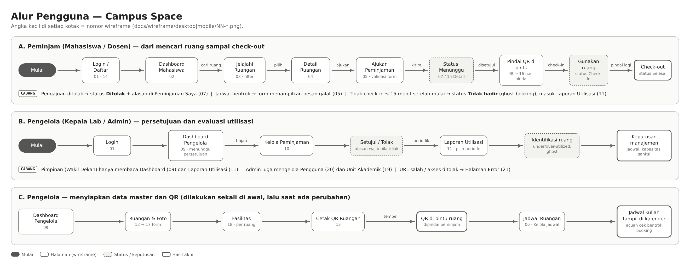

# Wireframe & Alur Pengguna — Campus Space

| Item | Isi |
|---|---|
| Issue Linear | PAD-23 [SA-04] Pembuatan Wireframe Seluruh Halaman (Desktop Laptop & Mobile HP) |
| Penyusun | Najma Afifah (System Analyst) |
| Jumlah halaman | **21 halaman** (seluruh layar aplikasi) × 2 ukuran layar (desktop 1440 px, ponsel 390 px) + 1 diagram alur pengguna |
| Acuan | Struktur Blade di `resources/views/` dan tampilan akhir di `docs/fe/hasil-ui/` |

Wireframe dibuat *low-fidelity* (abu-abu, tanpa warna merek) agar fokus pada **tata letak, hierarki informasi,
dan perilaku responsif**, bukan pada gaya visual. Kotak bergaris putus-putus biru dengan label seperti
`<main>` atau `<aside>` menandai **tag HTML5 semantik** yang dipakai tim FE pada bagian itu. Dengan begitu,
wireframe bisa dicocokkan langsung dengan struktur HTML (kriteria penerimaan PAD-23).

---

## 1. Isi folder

```
docs/wireframe/
  00-alur-pengguna.png        Diagram alur pengguna (peminjam & pengelola)
  desktop/NN-nama.png         Wireframe layar laptop (lebar 1440 px)
  mobile/NN-nama.png          Wireframe layar HP (lebar 390 px)
  sumber-html/                Sumber wireframe (HTML) + generate_wireframe.py
```

Untuk mengubah wireframe: edit `sumber-html/generate_wireframe.py`, jalankan `python generate_wireframe.py`, lalu buka
file HTML di browser. Gunakan DevTools → *Toggle device toolbar* (lebar 390 px) untuk melihat versi HP.
File HTML ini juga bisa diimpor ke Figma memakai plugin *html.to.design*.

---

## 2. Kerangka tata letak (berlaku di semua halaman setelah login)

| Bagian | Tag | Desktop (≥ 1024 px) | HP (< 700 px) |
|---|---|---|---|
| Sidebar menu | `<aside>` berisi `<nav>` | Kolom kiri tetap 232 px, menu per role | Disembunyikan; dibuka sebagai *drawer* lewat tombol ☰ |
| Topbar | `<header>` | Nama fakultas, avatar, nama + peran, tombol Keluar | Tombol ☰, nama fakultas, avatar, Keluar (nama pengguna disembunyikan) |
| Konten | `<main>` | Padding lebar, grid 2–4 kolom | Satu kolom, padding 12 px |
| Judul halaman | `<section>` | Breadcrumb, eyebrow, H1, deskripsi, tombol aksi utama di kanan | Tombol aksi pindah ke bawah judul |
| Kaki halaman | `<footer>` | Satu baris kiri–kanan | Dua baris bertumpuk |

**Aturan responsif yang sama di semua halaman:**

1. **Kartu KPI** (4 kolom) → bertumpuk 1 kolom.
2. **Tabel** → setiap baris berubah menjadi **kartu**; judul kolom tampil sebagai label kecil di atas setiap nilai.
   Pengguna tidak perlu menggeser layar ke samping.
3. **Grid kartu ruangan** (3 kolom) → 1 kolom.
4. **Form filter** satu baris → field bertumpuk, tombol aksi selebar layar.
5. **Kalender mingguan** (7 kolom) → daftar per hari, tanggal di kiri dan kegiatan di kanan.
6. **Konten + panel samping** (`<article>` + `<aside>`) → panel samping turun ke bawah konten utama.

Menu sidebar berbeda per role (rincian hak akses lengkap ada di [`docs/ROLE-PENGGUNA.md`](../ROLE-PENGGUNA.md)):

| Peminjam (`borrower`) | Pengelola (`lab_head`) | Admin (`admin`) | Pimpinan (`leader`) |
|---|---|---|---|
| Dashboard, Jelajahi Ruangan, Jadwal Ruangan, Peminjaman Saya, Pindai QR | Dashboard, Jelajahi Ruangan, Jadwal Ruangan, Peminjaman, Laporan Utilisasi + grup **Pengelolaan**: Ruangan & Foto, Fasilitas, Cetak QR Ruangan | Semua menu Pengelola + **Pengguna** dan **Unit Akademik** | Dashboard dan Laporan Utilisasi (baca saja) |

---|---|---|
| Dashboard, Jelajahi Ruangan, Jadwal Ruangan, Peminjaman Saya, Pindai QR | Dashboard, Jelajahi Ruangan, Jadwal Ruangan, Peminjaman, Laporan Utilisasi + grup **Pengelolaan**: Ruangan & Foto, Fasilitas, Cetak QR Ruangan | Semua menu Pengelola + **Pengguna** dan **Unit Akademik** |

---

## 3. Penjelasan per halaman

| No | Halaman | View Blade | Role | Isi utama & keputusan desain |
|---|---|---|---|---|
| 01 | Login | `auth/login` (`layouts/guest`) | Semua | Dua kolom: `<section>` brand di kiri, `<main>` berisi `<form>` di kanan. Field Email dan Kata Sandi memakai `required` dan `<label for>`. Di HP, panel brand menyusut jadi pita di atas form. |
| 02 | Dashboard Mahasiswa | `dashboard/borrower` | Peminjam | 4 kartu KPI, kartu **Peminjaman berikutnya** dengan jam buka check-in, tabel 5 peminjaman terbaru. Tujuannya agar peminjam langsung tahu apa yang harus dilakukan berikutnya. |
| 03 | Jelajahi Ruangan | `rooms/index` | Semua | Form filter (nama/kode, jenis, jumlah peserta `min=1`, fasilitas), jumlah hasil, grid kartu ruangan berisi foto, status *live* (Tersedia / Sedang dipakai / Perawatan), kapasitas, dan tombol Lihat Ruangan. |
| 04 | Detail Ruangan | `rooms/show` | Semua | `<article>` berisi foto, deskripsi, data ruangan (`<dl>`), dan chip fasilitas. `<aside>` berisi jadwal mendatang. Tombol utama **Ajukan Peminjaman** di judul. |
| 05 | Ajukan Peminjaman | `bookings/create` | Peminjam | `<form>` dengan Ruang (`select required`), Jumlah Peserta (`number min=1 max=kapasitas`), Waktu Mulai/Selesai (`datetime-local required`), Keperluan (`textarea required`). `<aside>` menjelaskan aturan, termasuk toleransi check-in 15 menit. |
| 06 | Jadwal Ruangan | `schedules/index` | Semua | Navigasi minggu, legenda (garis penuh = jadwal kuliah, putus-putus = peminjaman), kalender 7 hari dengan hari ini ditebalkan. Pengelola melihat tambahan tabel **Kelola jadwal** dan form **Tambah Jadwal**. |
| 07 | Peminjaman Saya | `bookings/index` (`@mine`) | Peminjam | Tabel pengajuan dengan badge status. Tombol tindakan menyesuaikan status: Ubah/Batalkan hanya saat masih bisa diubah. Paginasi 10 per halaman. |
| 08 | Pindai QR | `scan/index` | Peminjam | Kiri: area kamera, tombol Izinkan Kamera / Pindai dari Foto, dan input tautan manual (`<details>`) sebagai cadangan bila kamera ditolak. Kanan: hasil pindai untuk konfirmasi check-in/check-out. |
| 09 | Dashboard Pengelola | `dashboard/manager` | Pengelola, Pimpinan | 4 KPI ruang, daftar **Menunggu persetujuan** dengan tombol Setujui/Tolak langsung, dan `<aside>` status semua ruang saat ini. |
| 10 | Kelola Peminjaman | `bookings/index` | Pengelola | Filter status (chip), tabel peminjam–ruang–waktu–peserta–status. Tindakan Setujui/Tolak hanya muncul untuk status Menunggu. Alasan penolakan tampil di kolom tindakan. |
| 11 | Laporan Utilisasi | `dashboard/utilization` | Pengelola, Pimpinan | Form periode (`type=date`, akhir ≥ awal), 4 KPI (jam terjadwal, jam aktual, ghost, sesi belum lengkap), grafik batang terjadwal vs aktual per ruang, daftar ruang *underutilized* dan *overutilized*, serta tabel rincian. Halaman ini menjadi sumber analisis di `docs/ANALISIS-TEKNIK-INDUSTRI.md`. |
| 12 | Ruangan & Foto | `rooms/manage` | Pengelola | Tabel ruang (thumbnail, info, status, jumlah fasilitas/peminjaman) dengan tindakan Edit, Fasilitas, Hapus. Ruang yang punya riwayat peminjaman ditandai "Tidak dapat dihapus". |
| 13 | Cetak QR Ruangan | `rooms/qr` | Pengelola | Input alamat server yang bisa dibuka ponsel, lalu grid kartu QR siap cetak (nama, kode, QR, URL, tombol Perbarui QR). |
| 14 | Daftar Akun | `auth/register` (`layouts/guest`) | Tamu | Tata letak sama dengan Login. `<form>` berisi Nama Lengkap, Email (`type=email`), Kata Sandi, dan Ulangi Kata Sandi, semuanya `required` dengan `<label for>`. Akun baru otomatis berperan Peminjam. |
| 15 | Detail Peminjaman | `bookings/show` | Peminjam, Pengelola | `<section>` linimasa status (Diajukan → Disetujui → Check-in → Check-out, termasuk alasan bila ditolak), `<section>` Check-in/Check-out dengan tombol Pindai QR dan kode cadangan (`pattern="[A-Za-z0-9]+"`), `<aside>` rincian (`<dl>`) dan tindakan. |
| 16 | Hasil Pindai QR | `scan/show` | Peminjam | Muncul setelah QR terbaca. `<article>` peminjaman yang cocok di ruang itu + tombol **Check-in sekarang** (atau Check-out). Bila tidak ada peminjaman aktif, tampil pilihan Ajukan peminjaman ruang ini / Peminjaman Saya. |
| 17 | Form Ruangan (Tambah / Edit) | `rooms/create`, `rooms/edit` | Pengelola | `<form>`: Unit Akademik*, Tipe*, Kode* (`maxlength=30`), Nama* (`maxlength=150`), Gedung*, Lantai, Kapasitas* (`number min=1`), Status*, Deskripsi, dan `<fieldset>` Foto (JPG/PNG/WebP ≤ 2 MB, pratinjau, opsi hapus foto saat Edit). |
| 18 | Fasilitas Ruang | `facilities/index`, `facilities/edit` | Pengelola | Tabel fasilitas satu ruang (Nama, Jumlah, Kondisi, Tindakan) + `<aside>` form **Tambah fasilitas** (Jumlah `number min=1`, Kondisi `select`). Kondisi Rusak/Perawatan dibedakan dengan badge garis putus. |
| 19 | Unit Akademik | `admin/units/index`, `admin/units/edit` | Admin | Tabel unit (Kode, Nama, jumlah Ruang, Tindakan) + `<aside>` form **Tambah unit**. Unit yang masih dipakai ruang ditandai "Tidak dapat dihapus". |
| 20 | Kelola Pengguna | `admin/users/index`, `create`, `edit` | Admin | Tabel akun (Nama, Email, Role, Status Aktif/Nonaktif) + tombol Tambah Pengguna. Form tambah/ubah: Nama*, Email*, Role*, kata sandi, status aktif. |
| 21 | Halaman Error | `errors/layout` + `401`–`503` | Semua | Satu template terpusat (logo, ilustrasi, kode galat, judul, pesan) dengan tombol Kembali ke Dashboard / Halaman sebelumnya. Tamu melihat tombol Masuk. |

---

## 4. Alur pengguna



**A. Peminjam:** Login (atau Daftar Akun) → Dashboard → Jelajahi Ruangan → Detail Ruangan → Ajukan Peminjaman → status *Menunggu* (bisa dipantau di Detail Peminjaman) →
(disetujui pengelola) → Pindai QR di pintu → Hasil Pindai QR (check-in) → pakai ruang → pindai lagi (check-out) → *Selesai*.
Cabang: ditolak (alasan tampil di Peminjaman Saya), jadwal bentrok (pesan galat di form), tidak check-in dalam
15 menit (status *Tidak hadir*, tercatat sebagai *ghost booking*).

**B. Pengelola:** Login → Dashboard → Kelola Peminjaman → Setujui/Tolak → (berkala) Laporan Utilisasi → identifikasi
ruang *under/over-utilized* dan *ghost* → keputusan manajemen.

**C. Persiapan data:** Ruangan & Foto → Form Ruangan → Fasilitas → Cetak QR Ruangan → tempel QR di pintu → Jadwal Ruangan (jadwal
kuliah menjadi acuan cek bentrok booking).

---

## 5. Kesesuaian dengan struktur HTML semantik (kriteria penerimaan)

| Tag di wireframe | Dipakai di Blade |
|---|---|
| `<aside>` + `<nav>` sidebar | `layouts/app.blade.php` (`<aside id="cs-sidebar">`, `<nav aria-label="Navigasi utama">`) |
| `<header>` topbar | `layouts/app.blade.php` (`<header class="cs-topbar">`) |
| `<main>` konten | `layouts/app.blade.php` (`<main id="main-content">`), `layouts/guest.blade.php` |
| `<footer>` | `layouts/app.blade.php` (`<footer class="cs-app-footer">`) |
| `<section>` brand login | `layouts/guest.blade.php` (`<section class="cs-auth-brand">`) |
| `<form>` + `<label for>` | `auth/login`, `bookings/partials/form`, `rooms/partials/form`, `schedules/partials/form` |
| `<article>` kartu ruangan, `<section>` blok konten | komponen `room-card`; `<section>` di halaman dashboard & laporan |

Gambar wireframe dan tampilan akhir (`docs/fe/hasil-ui/`) memakai nomor dan urutan halaman yang sejalan, jadi
keduanya bisa dibandingkan berdampingan saat presentasi.
